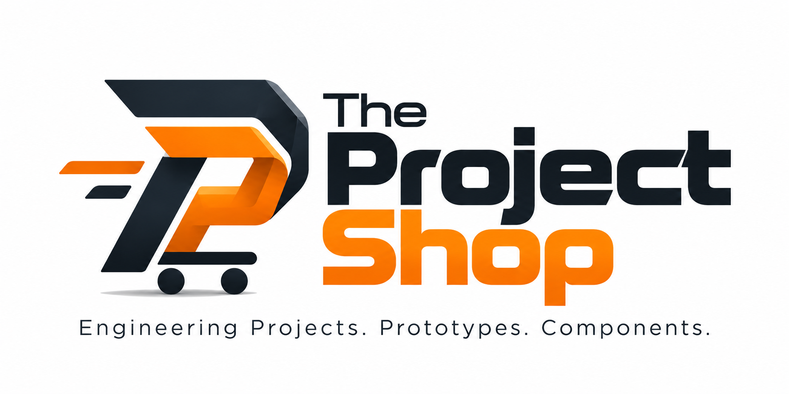

# Image Optimization — One-Time Setup

The logo (`logo.png`) is **806 KB** — the single biggest performance issue.
Run this once to generate a WebP version (≈ 80-90% smaller with transparency support).

## Option A — `squoosh-cli` (recommended, no install needed)

```bash
npx @squoosh/cli --webp '{"quality":82}' logo.png
```

This produces `logo.webp` alongside `logo.png`.

## Option B — `sharp-cli`

```bash
npm i -g sharp-cli
sharp -i logo.png -o logo.webp --webp
```

## Option C — Free online tools

- https://squoosh.app  (drag & drop, WebP, quality 80)
- https://tinypng.com  (PNG compression, no WebP)

---

## After generating logo.webp, update index.html

Replace the `` tag with a `<picture>` element:

```html
<picture>
  <source srcset="logo.webp" type="image/webp">
  
</picture>
```

Browsers that support WebP (95%+ as of 2025) will load the small WebP.
Others fall back to the PNG automatically.

## Expected result

| File       | Size    |
|------------|---------|
| logo.png   | 806 KB  |
| logo.webp  | ~60 KB  |
| Savings    | ~93%    |

